# Basic Guide

Build with `make`, start the app with `make run`, then open `http://<ip>:8888` in your browser.

The usual order is: log in, deploy the core, add subscribers, deploy the gNB, deploy UEs. Logs and images can be checked at any time.

## 1. Log in

Sign in with the account in fru-lab's `config.yaml`. The default is:

- Username: `admin`
- Password: `frulab`

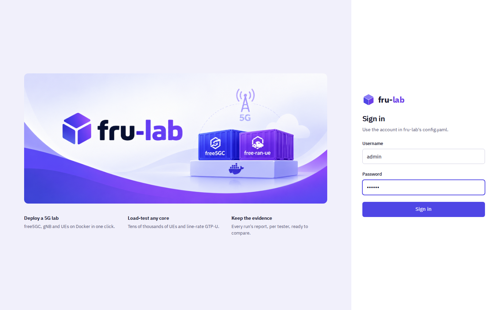

## 2. Find your way around

Every page shares the same frame:

- **Sidebar**: the "Core network" group (Dashboard, Subscribers, Logs, Images) and the "Load testing" group (Testers, Setup, Profiles, Runs, History, Bench). Click the fru-lab logo to go back to the Dashboard. "Log out" is at the bottom.
- **Header bar**: the breadcrumb on the left; on the right the UTC clock, the API state ("API connected" or "API not answering") and the signed-in user.
- **Status bar** at the bottom: the API state and the number of tester runs in progress.

## 3. The Dashboard

The Dashboard ("Lab dashboard") shows the whole lab:

- **Status row**: Core network, gNB, UE instances (running / subscribers) and Healthy NFs.
- **Network topology**: UE, gNB and the free5GC core with its network functions (NFs), linked by Uu, N2, N3, N4, N6 and the SBI bus. Each box has a status dot: Running, Deploying, Stopped or Unhealthy. Click the UE, the gNB, the core frame or a single NF to select it.
- **UE instances**: one row per subscriber.
- **Selected node** panel on the right: details of what you selected, its services, and its action buttons.

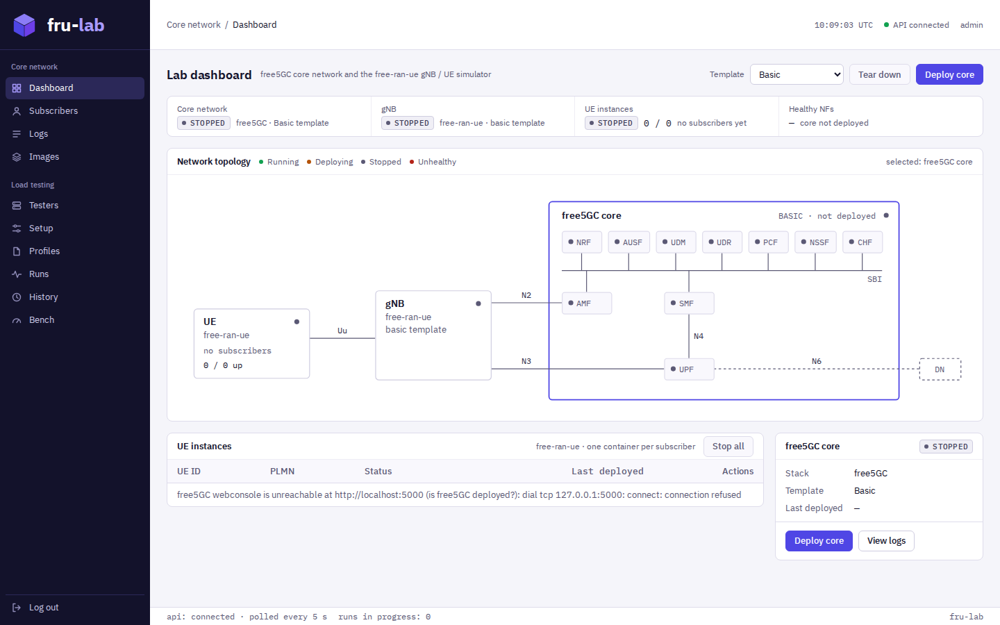

## 4. Deploy the core network

While the core is stopped, a **Template** picker is shown next to the header buttons:

- **Basic** - a single UPF.
- **ULCL** - the data plane is split into an Intermediate UPF (I-UPF) and a PDU Session Anchor UPF (PSA-UPF), chained over N9.
- **ULCL (Two Slice)** - two ULCL chains, each with its own SMF, I-UPF and PSA-UPF, one per network slice (S-NSSAI SD `010203` and `112233`).

Pick a template and click **Deploy core** (in the header, or in the Selected node panel when the core is selected). The core goes to Deploying, then Running once its containers are up. A deploy that fails, or takes longer than `deploy.timeout` in `config.yaml` (5 minutes by default), is taken down again.

Once the core is up, the picker is hidden and the template in use is shown in the status row, in the topology ("BASIC", "ULCL", "ULCL (TWO SLICE)") and in the Selected node panel. Click an NF in the topology or in the Services table to see that NF on its own.

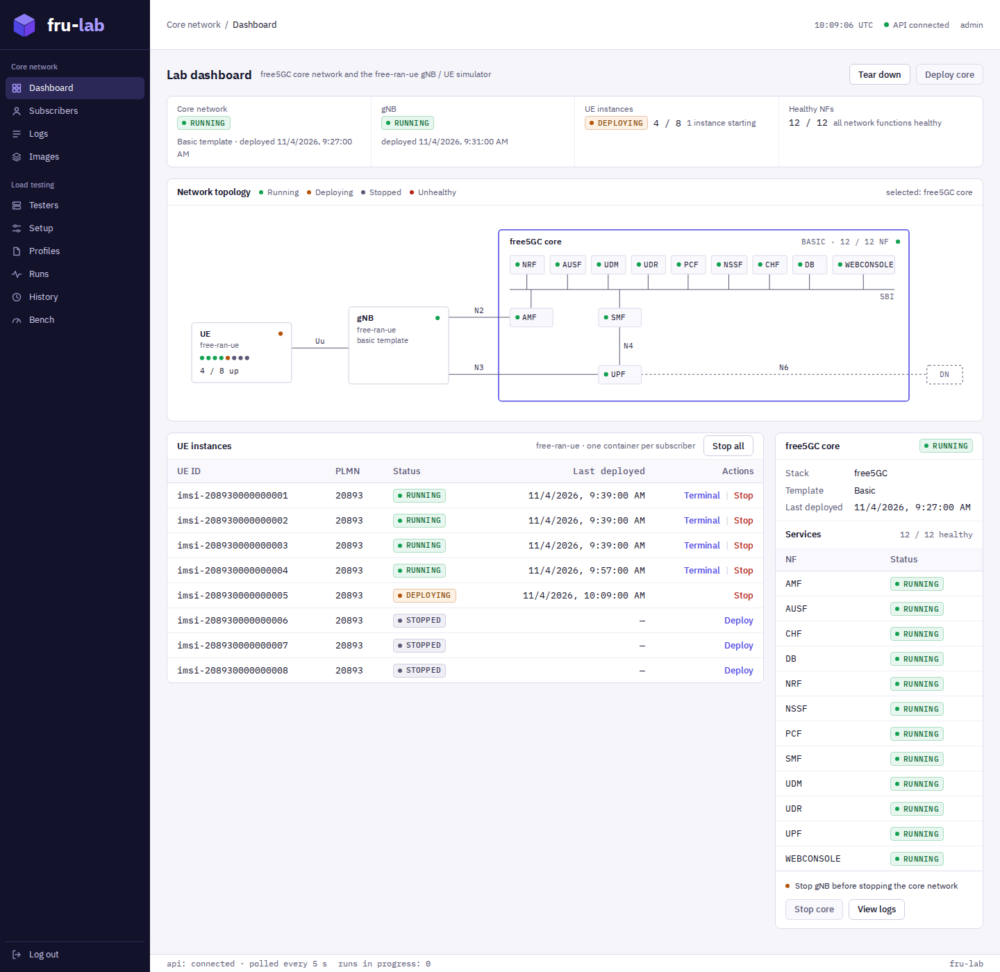

## 5. Deploy / stop order

fru-lab enforces a `Core -> gNB -> UE` order:

- Deploy: the core must be running before the gNB, and the gNB must be running before any UE.
- Stop: every UE must be stopped before the gNB, and the gNB must be stopped before the core.

When the order is not met, the button is disabled and the reason is shown above it, for example "Deploy the core network before deploying gNB", "Stop all UE instances before stopping gNB" or "Stop gNB before stopping the core network". A UE's Deploy link is disabled with "Deploy gNB before deploying a UE instance".

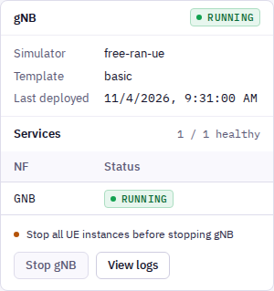

Anything that is not fully stopped can be stopped, including a deploy that is stuck in Deploying.

**Tear down** in the header stops everything in that order: all UE instances, then the gNB (both slices under Two Slice), then the core. It asks for confirmation first ("Stop every UE instance, the gNB and the core network?") and is disabled when nothing is up.

## 6. Add subscribers

Subscribers live in free5GC's webconsole, so the core must be deployed first. Open **Subscribers** in the sidebar.

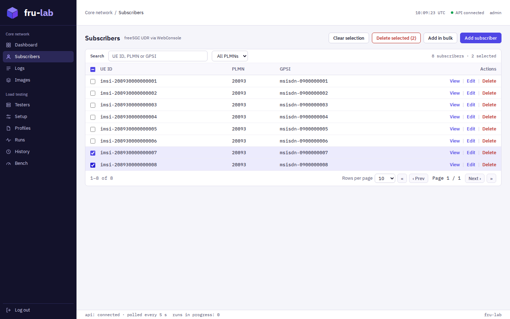

- **Search** by UE ID, PLMN or GPSI, and filter by PLMN ("All PLMNs"). The list is sorted by IMSI, 10, 50 or 100 rows per page.
- Each row has **View**, **Edit** and **Delete**. Delete asks for confirmation first.
- **Add subscriber** opens an empty form: identity and keys (SUPI, PLMN ID, GPSI, AMF, OPc, SQN, permanent key), the Subscribed UE AMBR, and one or more S-NSSAIs, each with its DNN configuration. Use **+ S-NSSAI**, **+ UP security** and **+ Flow rule** to add more. Click **Create** to save.

### Add many subscribers at once

Click **Add in bulk** and enter how many UEs to create (1 to 10,000), then **Continue**.

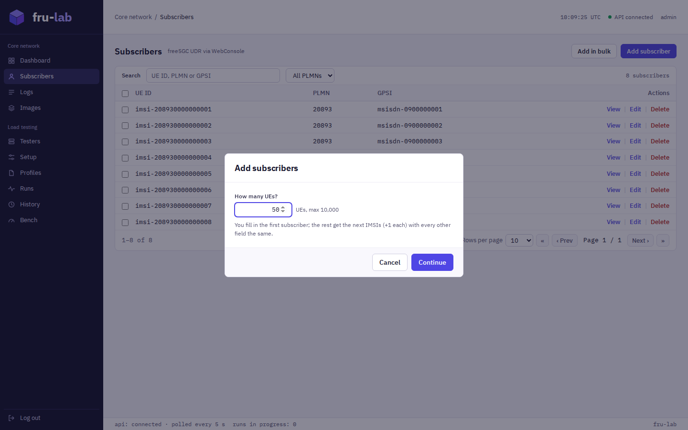

You fill in the first subscriber; the rest get the next IMSIs (+1 each) with every other field the same. The hint under SUPI shows the IMSI range, and the button reads **Create N**. Subscribers that fail to be created are listed at the bottom of the form.

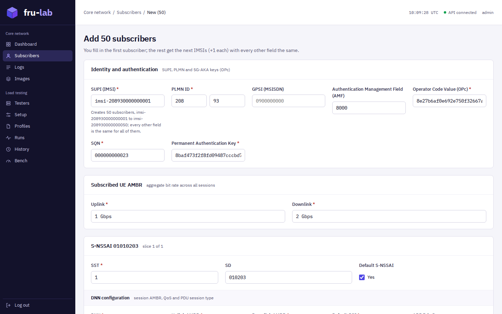

### Delete many subscribers at once

Tick the rows to delete. The header checkbox selects every subscriber that matches the search, on every page. Click **Delete selected (N)** and confirm. Subscribers that could not be deleted stay selected so you can retry. **Clear selection** unticks everything.

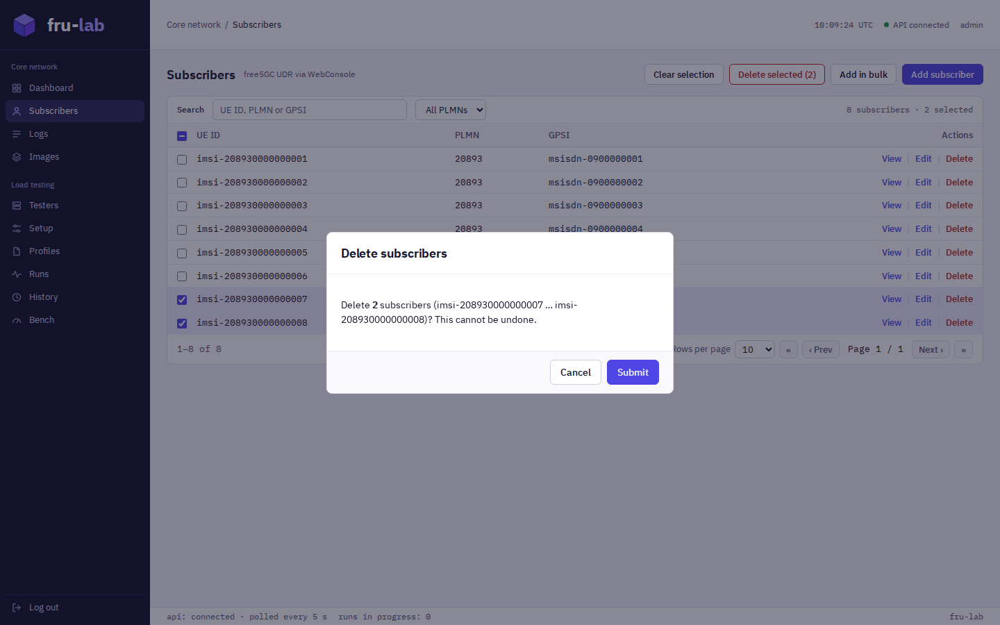

Under the ULCL (Two Slice) template, a subscriber's S-NSSAI SD (`010203` or `112233`) decides which slice's gNB its UE attaches to.

## 7. Deploy the gNB

Click the gNB in the topology and click **Deploy gNB** in the Selected node panel. Stop it with **Stop gNB**.

Under ULCL (Two Slice), the gNB is still one node and one button, but it deploys and stops two gNB containers, one per slice. The gNB box lists both slices with the number of UEs up on each, and its Services table shows `SLICE1-GNB` and `SLICE2-GNB`.

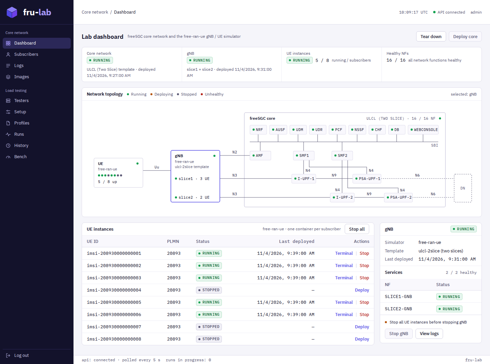

## 8. Deploy UEs

The **UE instances** panel lists every subscriber, deployed or not, with its PLMN, status and last deploy time. Each UE runs in its own free-ran-ue container.

- **Deploy** starts that subscriber's UE. **Stop** stops it.
- **Terminal** appears on a running UE.
- **Stop all** stops every UE that is up.

Click a UE ID to select it. The Selected node panel then shows its PLMN, GPSI and last deploy time, with **Deploy UE** / **Stop UE**, **Terminal** and **View logs**. Click the UE box in the topology to see the whole fleet ("Instances") instead.

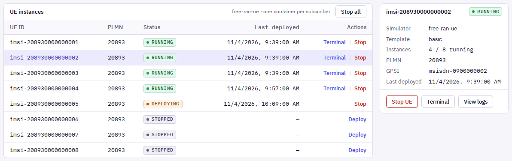

## 9. Open a UE terminal

Click **Terminal** on a running UE (in its row or in the Selected node panel). A terminal opens into that UE's container, so you can run commands there, for example ping through the UE's tunnel interface. Close it with the ✕ in its corner.

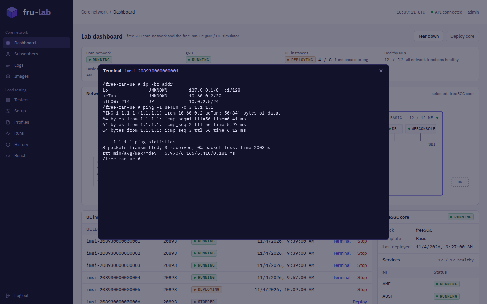

## 10. View logs

Open **Logs** in the sidebar, or click **View logs** on the Dashboard to jump straight to the selected node's logs.

- **Sources** lists the free5GC core, the gNB (gNB Slice 1 and gNB Slice 2 under Two Slice) and, under "UE instances", every UE that has been deployed at least once. The dot shows each one's status.
- When the core is selected, pick **All NFs** or a single NF.
- The viewer's head shows the source (an NF, the gNB or a UE) and its image, the line count and when the logs were fetched. The logs are a snapshot: click **Refresh** to fetch them again, or **Download** to save them as a `.txt` file.

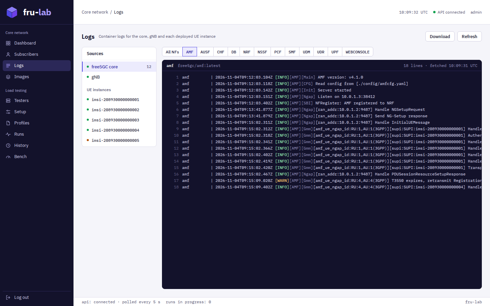

## 11. Images

The **Images** page lists the Docker images this app deploys and lets you pull, update and clear them. See the [Images Guide](./images-guide.md).

## 12. Load testing

The "Load testing" pages (Testers, Setup, Profiles, Runs, History, Bench) drive the Throughput Tester. They are covered in the [Throughput Tester guide](./superpowers/throughput-tester-guide.html) (in Chinese).
