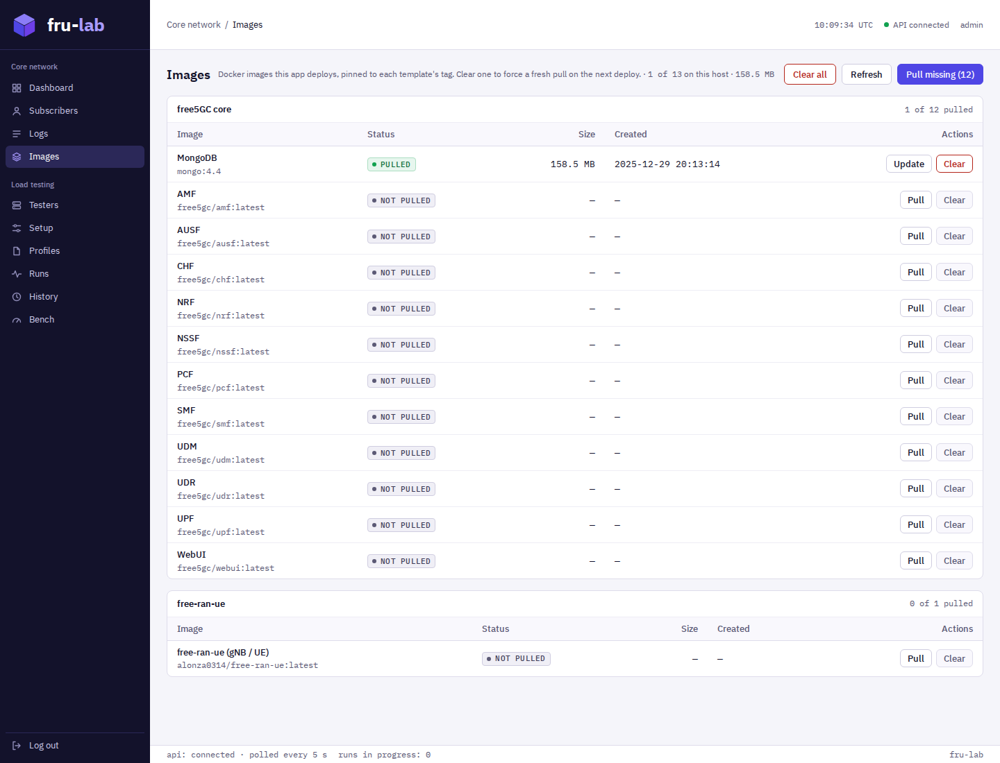
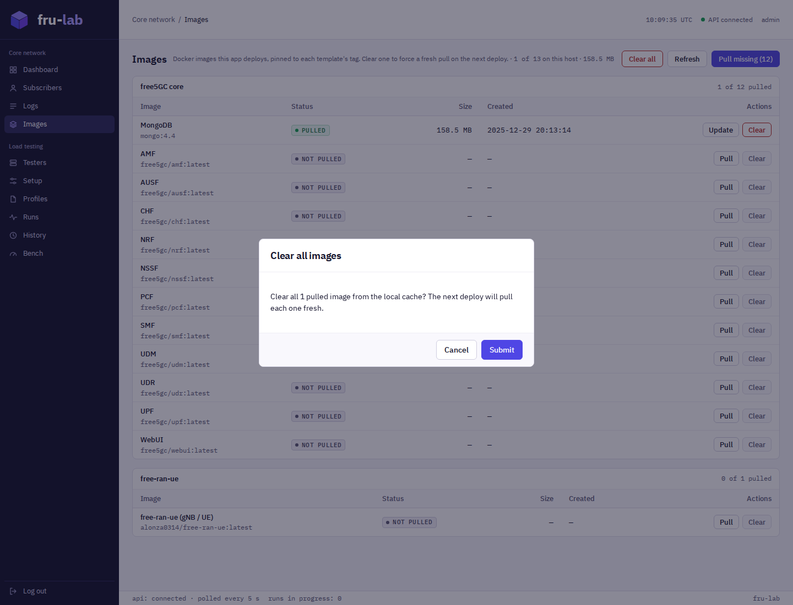

# Images Guide

The **Images** page (sidebar, "Core network" group) manages the Docker images this app deploys: the free5GC core's network functions, MongoDB, the webconsole (WebUI), and the free-ran-ue image shared by the gNB and every UE. Each one is pinned to the tag its compose template uses (usually `latest`), so this page is where you check whether they are on this host and pull a fresh copy when you want one.

## 1. Image list

The header shows how many images are on this host (for example "1 of 13 on this host") and their total size.

Images are grouped into "free5GC core" and "free-ran-ue", each with its own "N of M pulled" count. Each row shows:

- **Image**: the display name and the full reference (e.g. `free5gc/amf:latest`).
- **Status**: "Pulled" or "Not pulled".
- **Size** and **Created** (the image's creation time), for pulled images.
- **Actions**: Pull / Update and Clear.

**Refresh** reloads the list.

## 2. Pull or update an image

Click **Pull** on an image that is not pulled, or **Update** on one that is, to pull its pinned tag from its registry. The button shows "Pulling…" until the pull finishes, then the row updates.

**Pull missing (N)** in the header pulls every image that is not on this host, one after another. It is disabled when nothing is missing.

## 3. Clear an image

Click **Clear** on a pulled image to remove it from the local image cache, so the next deploy pulls it fresh. A confirmation dialog opens first; nothing is cleared until you click **Submit**. Clear is disabled for an image that is not pulled.

Docker refuses to remove an image that a container still uses, so stop the core, gNB or UEs first; otherwise the clear fails with an error.

## 4. Clear all images

**Clear all** in the header clears every pulled image in one go, for example to force a completely fresh set of pulls before a deploy. Like Clear, it asks for confirmation first. It is disabled when no image is pulled, and while a pull or clear is running.

